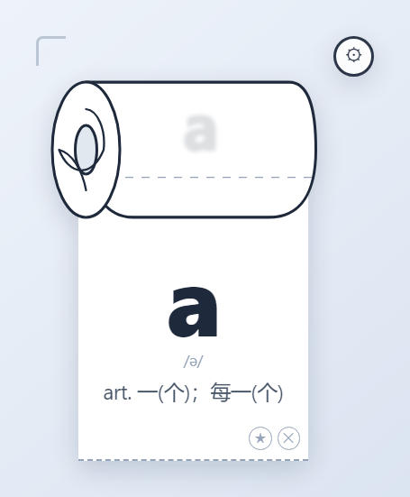
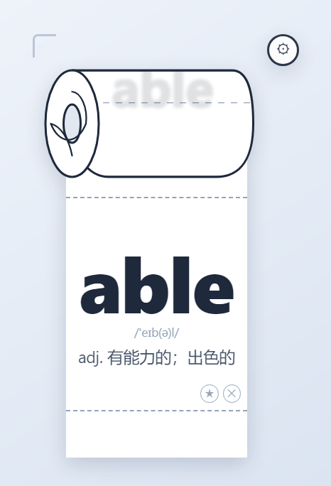
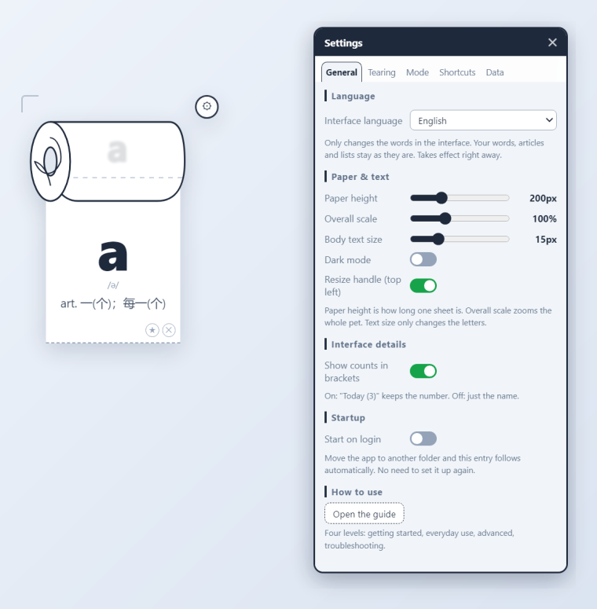
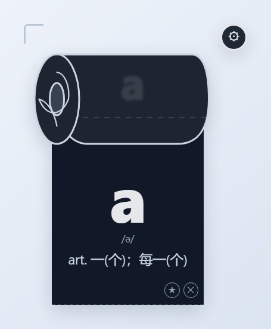
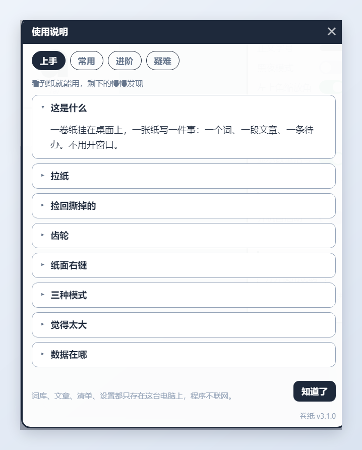
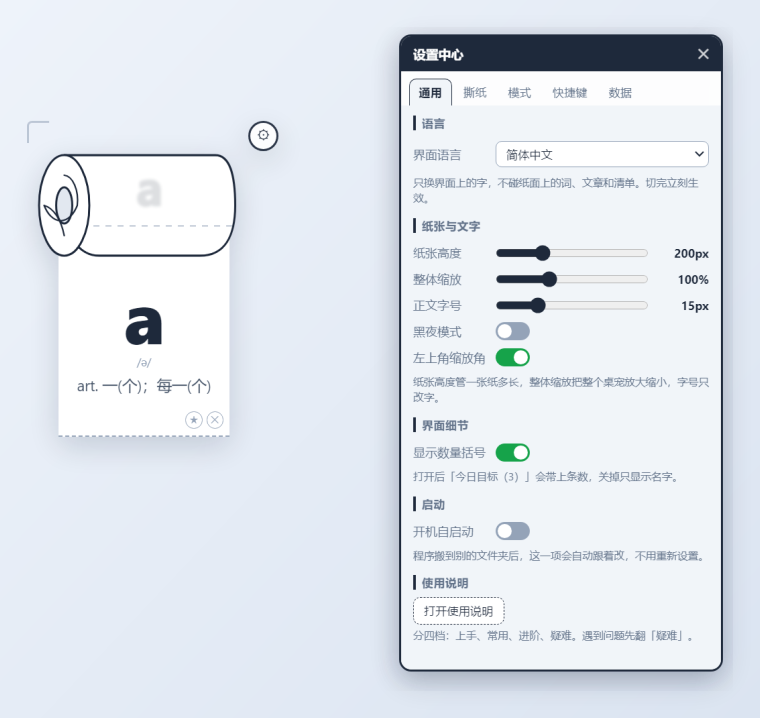

<div align="center">



# 卷纸 · 学习桌宠

<sub>Tissue · Roll-paper Study Companion</sub>

**一张纸一件事。拉下来看，撕掉就换下一件。**

*One thing per sheet. Pull to read, tear to move on.*


<sub>Windows 10/11 · macOS · 17,000+ 内置词条 · ≈17.4k 行代码 · 397 个文案 key × 5 语种</sub>

</div>

---

一个卷纸筒常驻在桌面上，纸带从筒口垂下来，一张纸写一件事——一个单词、一段文章、一条待办。把纸往下拉，最前面那张撕掉，下一张就接上。学习、阅读、清单三种模式各记各的进度，所有数据只留在这台电脑上，程序不联网。

A roll of paper — **Tissue** — sits on your desktop. Each sheet holds one thing — a word, a passage of an article, a to-do. Pull the strip down, tear the front sheet off, and the next one takes its place. Study, reading and checklist are three independent modes, each with its own progress. Everything stays on your machine; the app never talks to the network.

---

## 亮点 · Highlights

### 01 · 拉纸只动纸带，松手才结算

拖的时候一张纸都不撕，指针和回溯栈纹丝不动；松手才结算，三条分支都遵守同一条规矩——**屏幕上内容一像素不动，只有底部在变**。

- 整张滑出视口下边界的纸 → 静默退役（批量算一次，不逐张动画）
- 还看得见、又够阈值 → `flushTear` 撕掉最下面几张，其余纸坐标完全不变
- 不够阈值 → 停在原地，**一点也不回弹**

所以拖到一半松手，字不会跳一下；撕纸时也不会出现「整条纸带上滑」那种跳页。也正因为视口高恒等于「纸高 + 已拉出的量」，视口底边天然压在纸张边界上，停在任意位置都不会切掉半张纸。

<p align="center"></p>

**EN** Nothing is torn while your finger is down — the pointer and the undo stack stay frozen. The tear is settled on release, and all three branches follow one rule: **nothing on screen moves except the bottom edge.** Sheets that slid fully out of view are retired in a single batch; sheets still visible past the threshold are removed with a silent flush, so every other sheet keeps its exact position; below the threshold the strip simply stays put, with no spring-back. Because the viewport height always equals "one sheet plus what you pulled", its bottom edge lands on a sheet boundary — it can never cut one in half.

### 02 · 能拉多长，只由内容决定

视口长到上限之后 `pull` 就封顶，多出来的位移全部记在 `retract` 上，纸带继续在视口里往下滚——纸带长度和窗口高度无关，学习模式是无限的。

整个拖拽过程**一次 `win:resize` 都不调**。Windows 上透明无边框窗口整窗重排是卡顿主因，这里改成纸带自己滚、窗口不动。

**EN** Once the viewport hits its cap, further movement is recorded as scroll instead of height, so the strip keeps rolling inside a window that never resizes. Reflowing a transparent frameless window on every frame is the main source of jank on Windows; this design avoids it entirely.

### 03 · 纸带是虚拟化列表，不是动画

内容由 `provider.getPaper(index)` 这个纯函数给出，DOM 只是 `index` 的缓存，任何时候常驻节点不超过 15 个。指针只有 `TearController` 能改，撕纸和回溯都是「指针先变 + 位移同步补偿 + 动画归零」，所以视觉连续、内容不闪。

实测 1 万词条的词库滚动无掉帧；超长单词（45 字符英文 / 15 字中文）自动缩字号并折行，**不裁字尾**。

**EN** Papers come from a pure function of the index, and the DOM is just a cache — never more than 15 live nodes. Only the tear controller mutates the pointer, and both tearing and undoing compensate the visual offset, so content never flickers. A 10,000-entry word list scrolls without dropped frames; very long words shrink and wrap instead of being clipped.

### 04 · 三种模式，各记各的账

| 模式 | 一张纸是什么             | 进度怎么记                 |
| -- | ------------------ | --------------------- |
| 学习 | 一个单词（词形 / 音标 / 释义） | 已撕到第几张，重启接着来          |
| 阅读 | 一段文章的一页            | 按字符偏移锚定，改字号、缩放后仍停在同一段 |
| 清单 | 清单的一页（可勾选、星标、随记）   | 当前首屏第几页               |

切模式只换内容源和回溯栈，互不干扰；每种模式有自己的空态文案，不会出现「学习模式的提示跑到清单里」。

**EN** Switching modes swaps the content provider and the undo stack, nothing else. Reading progress is anchored to a character offset, so it survives font-size and zoom changes; study progress survives restarts.

### 05 · 五种语言，一个 i18n 实例

设置 → 通用 → 界面语言：简体中文 / 繁體中文 / English / 日本語 / Français，另加「跟随系统」。

一份词典两个进程共用：`renderer/js/locales/*.js` 是 UMD 文件，主进程 `require()`、界面用 `<script>` 加载，只有一套文案。切完语言，界面、纸面右键菜单、托盘菜单、窗口标题、连排版窗口一起换。

两个地方最容易出错，这里都踩过：

1. **语言名是数据键**。「英语」「其他1」既是显示名也是数据键，翻译了写回就是新语言、老数据全对不上。所以显示走 `langName()`，写回永远用中文原值。
2. **原生 UI 是一次性快照**。托盘菜单拼好就固定，切语言必须 `tray.refresh()` 重建，否则菜单还是旧语言。

<p align="center"></p>

**EN** One dictionary, two processes: the locale files are UMD modules, so the main process `require`s the very files the renderer loads with `<script>`. Switching a language repaints the UI, the paper context menu, the tray menu, window titles and the formatting window at once. Two traps: language names double as data keys (translate the display, never the stored value), and native menus are one-shot snapshots that must be rebuilt.

### 06 · 排版窗口，用起来像 Word

清单里的任意一条都能单独排版：独立窗口（默认 300×240，拉大后记住）、`Ctrl+S` 保存、`Esc` 取消。工具带上有加粗 / 斜体 / 下划线 / 删除线 / 曲线（波浪线）、10–32px 字号，以及仿 Office 的点开式色板——`A` 选字色、`ab` 选突出显示，8×3 主题色 + 任意十六进制。

高亮一律存成半透明，黑纸上也不会把浅色字吃掉；纸色跟随主程序的黑白主题，编辑器开着时切主题立刻跟着变。保存只回传 HTML，由主窗口净化后才落盘，脚本和外部样式一律丢弃。

<p align="center"></p>

**EN** Any checklist item opens in its own formatting window with bold / italic / underline / strike / wavy, a size picker and an Office-style swatch popover. Highlights are stored semi-transparent so they work on a black sheet too. Saving returns HTML only, and the main window sanitises it before writing.

### 07 · 导入不挑格式

| 格式             | 怎么处理                                                     |
| -------------- | -------------------------------------------------------- |
| `.docx`        | 自己解 OOXML，文字 / 公式 / 占位符按原顺序取出；OMML 公式转 Unicode；表格按行合并    |
| `.pdf`         | pdfjs 取文本项，按坐标聚行重排；四列词表（序号 / 单词 / 音标 / 释义）改走按列切块，续行并回上一条 |
| `.txt` / `.md` | BOM → chardet → gb18030 三级兜底，不乱码                         |
| `.doc`         | 明确拒绝并提示另存为 `.docx`，不假装能读                                 |

导入词表时还能顺手选语言（学习语言 / 释义语言两个下拉互斥），选错了事后在设置里改，进度不丢。

**EN** docx is parsed from OOXML directly (order preserved, OMML converted to Unicode, tables merged per row). PDFs go through coordinate-based line regrouping, with a separate column-slicing path for four-column vocabulary layouts. Plain text tries BOM, then chardet, then gb18030.

### 08 · 数据只在自己电脑上

五个 JSON 分文件（`settings` / `learn` / `leisure` / `checklists` / `torn`），写入走「`.tmp` → `.bak` → `rename`」的原子流程。撕纸、勾选、切模式这类操作即时落盘，滚动位置这种高频小改动防抖 500ms。

文件真坏了不会静默重置：自动尝试 `.bak`，然后把「哪个文件坏了、是恢复了还是重置了」在窗口加载后提示一次——不让你以为「设置自己变回去了」。

**EN** Five JSON files, atomic writes via tmp → bak → rename. Critical actions are flushed immediately, cosmetic state is debounced. If a file is corrupt the app falls back to `.bak` and tells you which file broke and what it did about it.

---

## 界面一览 · Screens

|                                                                                                                                   |                                                                                                                           |
| --------------------------------------------------------------------------------------------------------------------------------- | ------------------------------------------------------------------------------------------------------------------------- |
| <br />**黑夜模式** — 黑纸白字，卷筒（SVG 造型层）也跟着变黑                           | <br />**使用说明** — 四档（上手 / 常用 / 进阶 / 疑难）、36 条一句话，第一次打开自动弹 |
| <br />**设置中心** — 通用 / 撕纸 / 模式 / 快捷键 / 数据五个分区，语言、纸张、启动、说明一页管完 | <br />**英文界面** — 同一套布局，标签变长也不溢出                   |

---

## 部署与分发 · Deploy & Distribution

### 环境要求 · Requirements

| 项       | 要求                                             |
| ------- | ---------------------------------------------- |
| Node.js | 18 或更高（Electron 28 自带 Node 18）                 |
| npm     | 9+                                             |
| 系统      | Windows 10/11 x64（已出包）；macOS 12+（可运行，需自行加构建目标） |
| 磁盘      | 源码 + 依赖约 600MB，安装包 91MB                        |

### 从源码运行 · Run from source

```bash
git clone https://github.com/xiaoyuanyysx/tissue-pet.git
cd tissue-pet
npm install          # 首次会下载 Electron（约 90MB）
npm start            # 启动桌宠
```

国内下载 Electron 慢，先设镜像再装：

```bash
npm config set ELECTRON_MIRROR https://npmmirror.com/mirrors/electron/
# PowerShell: $env:ELECTRON_MIRROR="https://npmmirror.com/mirrors/electron/"
```

`canvas` 走 N-API 预编译二进制，正常不需要本地编译；万一装失败，`npm rebuild canvas` 再试一次。

### 打包 · Build installers

```bash
npm run i18n:check   # 先验一遍五份词典（key 齐平 / 变量一致）
npm run build        # electron-builder，约 3–4 分钟
```

产物在 `dist/`：

```
dist/tissue-pet Setup 3.1.0.exe     NSIS 安装版（可选安装目录、建桌面快捷方式）
dist/tissue-pet 3.1.0.exe           portable 绿色版（单文件，双击即用）
```

两条必须知道的打包规则：

1. **`build.files` 是白名单**。`preload-editor.js` 不在 `main/**` 或 `renderer/**` 下，漏写就进不了 `app.asar`，装完打开排版窗口直接报错——开发态完全正常，最容易漏。改完跑一次对账：
   ```bash
   npx --no-install asar list dist/win-unpacked/resources/app.asar | grep preload
   #  \preload-editor.js
   #  \preload.js
   ```
2. **词库靠 `extraResources` 分发**。源码里读 `vocab/`，打包后读 `resources/vocab/`，不是打进 asar 的。

macOS 目前没有预置构建目标。要出 dmg 就在 `package.json` 的 `build` 里加 `mac` 段，并准备签名证书（未签名只能本机运行）。

### 目录结构 · Layout

<details>

<summary>展开（点击）· Click to expand</summary>

```text
tissue-pet/
├── main/                       主进程：唯一拥有系统能力的一层
│   ├── index.js                生命周期 / 单实例 / 服务装配 / IPC
│   ├── window-manager.js       透明置顶 / 穿透 / DPI / 缩放 / 隐藏恢复
│   ├── editor-window.js        排版独立窗口
│   ├── tray.js                 A4 托盘菜单
│   ├── i18n.js                 主进程文案（与界面共用一份词典）
│   ├── auto-launch.js          开机自启动（含换路径自愈）
│   ├── shortcuts.js            快捷键双轨
│   ├── persist.js              分文件 + 原子写 + 损坏自愈
│   ├── ipc-router.js           通道注册 + 统一结果包装
│   ├── dict-service.js         内置 / 导入词库
│   ├── paths.js                资源与词库目录解析
│   └── importer/               docx（OOXML 自解析）/ pdf / txt·md
├── preload.js · preload-editor.js   两个 contextBridge 白名单
├── renderer/
│   ├── desk-pet.html · editor.html
│   ├── css/                    app.css（含黑夜变量）· editor.css
│   └── js/
│       ├── app.js              渲染层总控
│       ├── engine/             paper-stream / tear-controller / backtrack-stack
│       ├── providers/          learn / leisure / checklist / mode-router
│       ├── leisure/            paginator（确定性分页）/ measure
│       ├── ui/                 settings-center / guide / context-menu / …
│       ├── i18n.js + locales/  五语种词典（zh-CN / zh-TW / en / ja / fr）
│       └── editor.js · rich.js · pet-view.js · util.js
├── assets/screenshots/         文档配图（7 张）
├── build/icon.ico              应用图标（16–256 七档，脚本生成）
├── resources/tray.png          托盘图标
├── vocab/                      内置词表（中考 / 高中 / 四级 / 六级 / 雅思）
├── scripts/                    check-i18n.js · make-icon.js
└── LICENSE
```

</details>

### 常用命令 · Commands

| 命令                          | 作用                                  |
| --------------------------- | ----------------------------------- |
| `npm start`                 | 启动                                  |
| `npm run smoke`             | 无界面自检，4 秒后打印渲染层状态并退出（仅开发态）          |
| `npm run i18n:check`        | 五份词典对账：key 齐平、`{变量}` 一致、说明结构一致、反扫漏译 |
| `npm run build`             | 打包安装版 + 绿色版                         |
| `node scripts/make-icon.js` | 重新生成应用图标                            |


### 常见问题 · Troubleshooting

**启动后桌面上什么都没有**
窗口可能被隐藏了（托盘「隐藏/显示」是同一个开关），按 `Ctrl+Shift+P` 或点托盘图标叫回来。如果之前拖到了屏幕外，重启后会被钳回工作区；多显示器拔掉后也是同样处理。

**打包版词库下拉是空的**
`extraResources` 没带上。检查 `dist/win-unpacked/resources/vocab/` 里有没有那几个 `.txt`——词库不进 asar，走的是资源目录。

**安装版打开排版窗口报错或空白**
`preload-editor.js` 没进 `app.asar`（见上面第 1 条）。用 `npx --no-install asar list` 对一下，缺了就补进 `build.files` 重新打包。

**改了 `main/**` 不生效**
主进程没有热重载，改完要 `Ctrl+C` 再 `npm start`；只改 `renderer/**` 的话 `Ctrl+R` 刷新窗口就够。

**EN** Nothing on screen after launch? The window is probably hidden — press `Ctrl+Shift+P` or click the tray icon. Empty word-list dropdown in a packaged build? `extraResources` did not include `vocab/`. Formatting window broken after install? `preload-editor.js` is missing from `app.asar`. Main-process changes need a restart; renderer changes just need a reload.

---

## 怎么用 · How to use

1. **拖**：按住卷筒或纸面空白处，把桌宠挪到任意位置。
2. **拉**：按住纸面往下拖，纸带跟着出来；松手结算（够阈值撕一张，不够停住）。
3. **捡回来**：按 `Shift`（窗口聚焦时）或 `Ctrl+Shift+B`，也可以点托盘「回溯上一张」，找回刚撕掉的纸（默认 10 张，上限 50）。
4. **右键**：纸面上右键改样式、标星、写随记、交换上下语言；空白处右键切模式。
5. **齿轮**：改语言、纸张高度、字号、黑夜模式、快捷键、数据备份，以及打开使用说明。

第一次打开会自动弹一次使用说明，之后在 设置 → 通用 里再打开。

**EN** Drag the roll to move the pet. Pull the sheet down to advance. Press `Shift` while the window is focused, or `Ctrl+Shift+B`, or use the tray menu, to bring back what you just tore (10 by default, 50 max). Right-click the sheet to restyle, star, annotate or swap languages; right-click empty space to switch modes. The gear opens language, paper size, dark mode, shortcuts and data tools.

---

## 数据与隐私 · Data & privacy

程序不联网、不上报、不带统计。所有状态在 Electron 的 `userData` 目录：

| 平台 | 路径 |
|---|---|
| Windows | `%APPDATA%\tissue-pet\`（开发态与安装版同名） |
| macOS | `~/Library/Application Support/tissue-pet/` |

> 改名前的版本（程序名叫「学习卷纸桌宠」）数据放在 `%APPDATA%\学习卷纸桌宠\`。新版读的是 `tissue-pet`，旧数据不会自动搬过去——需要的话把这五个 JSON 拷进新目录即可。

| 文件 | 内容 |
|---|---|
| `settings.json` | 主题、缩放、语言、快捷键、面板位置、当前模式 |
| `learn.json` | 学习进度、标星、不显示词、词库语言 |
| `leisure.json` | 阅读进度、资料库索引 |
| `checklists.json` | 清单、条目富文本、随记、勾选 |
| `torn.json` | 各模式当前纸位（回溯栈不落盘，只服务本次运行） |

换电脑迁移：退出程序，把这五个文件复制到新机器的同一位置即可。「恢复默认设置」「清空全部数据」不会动导入的文档与词库文件，需要单独删。

**EN** No network, no telemetry. All state lives in five JSON files under `userData`. To migrate, quit the app and copy those files. "Reset settings" and "Clear all data" never touch imported documents or word lists. Builds before the rename kept their data in `%APPDATA%\学习卷纸桌宠\` — copy those five JSON files into `%APPDATA%\tissue-pet\` to carry progress over.

---

## 关键机制 · How it works

**逻辑纸模型**：内容由纯函数产出，DOM 是 `index` 的缓存；指针只由 `TearController` 改。撕纸与回溯都遵循「指针先变 → 位移同步补偿 → 动画归零」，所以视觉连续。

**纸带方向**：单张纸的位置是 `y(ci) = shift − (ci − top) × 纸高`，index 越大越靠上。下拉时新纸从卷筒下方进入、把旧纸往下推；最先拉出来的落在最下面，也最先被撕。

**确定性分页**：离屏 canvas 逐字测量断行，产出带 `charStart/charEnd` 的页计划；缓存键是 `docId:纸宽:字号:纸高`。布局变了就按字符锚点二分找新页号，进度不丢。

**窗口移动**：不用 `-webkit-app-region: drag`（在「有 transform 缩放 + 透明 + 穿透」三件事叠加时命中测试会失效），改成 `pointermove` 增量 + `win:moveBy`，同时临时关掉穿透。

**鼠标穿透**：`mousemove + elementFromPoint` 命中白名单；新增浮层必须把选择器加进 `InteractionLayer`，否则那块区域会穿透到桌面。

**EN** The strip is a virtualised list driven by a pure function; the DOM is a cache. Position is `shift − (index − top) × sheetHeight`, so newer sheets sit higher and are torn first. Pagination uses off-screen canvas measurement with a character-offset anchor, so progress survives layout changes. Window dragging avoids `-webkit-app-region` (it breaks with transforms plus transparency plus click-through) and uses pointer deltas instead.

---

## 已知限制 · Known limitations

- **PDF 只支持有文本层的文件**，扫描件返回提示，不做 OCR。页内图片按页末占位（`[.png 图片 × n]`）计入内容。
- **docx 复杂公式**（矩阵嵌套、手写体）可能降级为 `[公式]`；常见上下标、分式、根式、求和积分可转 Unicode。
- **拉丁语系细分不出**：法语 / 德语 / 西班牙语都记作「英语」；样本过短时不用 franc 猜，导入后手选即可。
- **回溯只服务本次运行**：重启后栈为空，不会回到上次启动前的内容。
- **清单默认不撕纸、只滚动**：每页只是同一个清单的分页视图，滚上去就回到第一页；想撕就在 设置 → 模式 → 清单 关掉「不撕纸」。
- **开机自启动是系统级设置**，不在「恢复默认 / 清空数据」范围内。被任务管理器或安全软件禁用时，面板给「打开系统启动项设置」的直达按钮；程序搬家后手动打开一次即自愈。
- **卸载前先关掉自启动**，否则 `Run` 里会留一条指向已删除程序的记录（系统会自行忽略）。
- **Electron 28 已停止维护**，升级要重测透明窗口、穿透命中、DPI、canvas 全链路，留到下一版。
- **网页抓取（P2）未实现**，只预留了扩展点。

**EN** PDFs need a text layer (no OCR). Complex docx formulas may degrade to a placeholder. Latin languages other than English are not distinguished automatically — pick the language manually after import. The undo stack is per-session. "Tear mode" for checklists is off by default. Auto-start is a system setting, outside the data reset. Electron 28 is end-of-life; upgrading needs a full re-test of transparency, click-through and DPI.

---

## 许可 · License

[MIT](LICENSE) © 2026 xiaoyuanyysx
